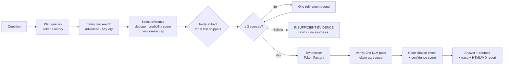

# Evidence-First Research Agent

> **ODSC x Nebius Hackathon submission.** Challenge: *Build a research agent that brings its sources.*

**One-line pitch:** Ask a research question and get a short, claim-by-claim cited brief that admits conflicts and gaps — or refuses, with a clear reason, when the evidence is not there.

- **Demo video (2–3 min):** https://www.youtube.com/watch?v=hSF6UNs_zaM (Unlisted; fallback draft — real tests, offline stub labelled as stub, live Tavily search; live end-to-end run not possible — Nebius Token Factory does not support Pakistan, confirmed by Nebius Support 2026-11-20)
- **Team:** EvidenceFirst — Daim Ali (solo), daimx1214@gmail.com
- **Model:** `MiniMaxAI/MiniMax-M3` on Nebius Token Factory · **Search:** Tavily (`search_depth="advanced"`, `max_results=5`)

## The problem

Freelancers doing client market research, and students writing assignments, lose hours opening tabs and still cannot tell which claims are actually supported. Search snippets contradict each other, low-quality content farms rank next to primary sources, and chatbots answer confidently with no way to check them. This agent runs the search, ranks the evidence by credibility, writes a cited brief in about a minute, and — when the evidence is thin — says so instead of guessing. The user checks sources instead of hunting for them.

## How it works



1. **Plan** — the Token Factory model splits the question into up to 4 distinct search queries, including one aimed at surfacing contradicting evidence.
2. **Search** — Tavily `search_depth="advanced"`, 5 results per query. Nothing comes from training memory.
3. **Select evidence** — URLs are normalised (tracking params stripped) and deduplicated; weak Tavily scores (< 0.2) and near-empty snippets are dropped; at most 2 results per domain; the top 8 are kept, ranked by combined relevance + **credibility score**.
4. **Credibility scoring** — `.edu` / `.gov` / `.ac.uk`, official docs and established news/reference publishers score high (0.85–0.95); generic sites score ~0.5; hyphen-stuffed domains, low-trust TLDs (`.xyz`, `.click`, …) and SEO-spam patterns score low (0.15–0.25). The score is a ranking heuristic about the *publisher* — it never invents facts, and the verification pass still checks every claim.
5. **Extract** — for the top 3 sources whose snippet is thin (< 600 chars), Tavily `extract` pulls fuller page content (guarded: any failure is logged and the run continues on snippets).
6. **Refine or stop** — under 3 usable sources triggers exactly one refinement round with new, more specific queries. Still under 3 → the agent prints `INSUFFICIENT EVIDENCE`, exits with code 2, and **never calls the model for an answer**.
7. **Synthesise** — the model writes in its own words, using only the numbered sources; every factual claim must end with `[n]`; facts and `Inference:` are labelled separately; a **Conflicts and gaps** section is required.
8. **Verify (twice)** — a second LLM pass checks each cited claim against its source text and flags unsupported ones (with a fallback to the code check if the pass fails), then a code-level check strips any citation pointing to a non-existent source and counts uncited lines. The result carries a **confidence score (0–100)** computed from source count, mean credibility, mean relevance, verification outcome and citation coverage — not from the model's self-report.
9. **Report** — terminal answer, `--json` output, a research trace on stderr / `--trace-file`, and standalone `--html` / `--md` reports.

## Required services

| Requirement | How we use it |
| --- | --- |
| Nebius Token Factory (inference) | Model: `MiniMaxAI/MiniMax-M3` (override with `NEBIUS_MODEL`) via the OpenAI-compatible endpoint `https://api.tokenfactory.nebius.com/v1` — query planning, refinement, synthesis, verification |
| Tavily (real-time web search) | `search_depth="advanced"`, 5 results per query; `extract` for fuller content on the top 3 thin sources; every cited source comes from these results |

## Setup

```bash
git clone https://github.com/Daimx1214/evidence-first-research-agent
cd evidence-first-research-agent
python -m venv .venv && source .venv/bin/activate   # Windows: .venv\Scripts\activate
pip install -r requirements.txt
cp .env.example .env   # add your keys — never commit .env
python src/agent.py "Your research question here"
```

Optional flags:

```bash
python src/agent.py "Your question" --json                          # full result as JSON
python src/agent.py "Your question" --trace-file docs/trace.json    # research trace (no secrets)
python src/agent.py "Your question" --html reports/answer.html --md reports/answer.md
python src/agent.py "Your question" --no-extract                    # skip Tavily extract
```

Trace lines print to **stderr** while the run progresses, so stdout stays clean for `--json` piping. Keys live only in `.env` (git-ignored) — never in code, traces, reports or the video.

Run the tests (no API keys needed):

```bash
python -m pytest -q
```

## Example

> **Offline stub example — NOT a live run.** The answer below is real output
> of the agent pipeline run by `scripts/offline_stub_run.py` with fake
> clients (no keys, no live APIs) — but every cited URL is a **real, openable
> page** whose text supports the claim (verified 2026-11-20). It shows the
> answer format, citation behaviour and confidence scoring. A real live run
> still needs a Nebius key (blocked for Pakistan — see "Live evidence so far").

**Question:** What are the current evidence-based benefits and risks of intermittent fasting?

**Answer (excerpt):**
> Short answer: randomised trials report weight loss with intermittent fasting similar to continuous restriction, with headaches and fatigue in the first few days [1][2].
>
> - Weight loss was similar in the intermittent and continuous restriction groups after one year [1].
> - Headaches and fatigue are common in the first few days of fasting [2].
> - Long-term adherence is uncertain: hunger may limit adherence to intermittent restriction [1]. The sources do not cover outcomes beyond one year [1][3].

**Sources:**
[1] Effect of intermittent versus continuous energy restriction on weight loss, maintenance and cardiometabolic risk: A randomized 1-year trial — https://www.sciencedirect.com/science/article/abs/pii/S0939475318301005
[2] 9 Possible Side Effects of Intermittent Fasting — https://www.healthline.com/nutrition/intermittent-fasting-side-effects
[3] The Effects of Continuous vs. Intermittent Caloric Restriction on Fat Loss: A Randomized Controlled Trial — https://pmc.ncbi.nlm.nih.gov/articles/PMC13258728/

**Confidence:** 75/100 (high) — 3 usable sources, mean credibility 0.78, verification 2/2 claims supported, 3 sources cited, 0 long uncited lines · **Trace:** `docs/trace.example.json` (offline stub example — see below). The same run is saved as an HTML report with clickable citations: `reports/stub-answer.html` (generated locally; git-ignored).

### Example trace (offline stub — NOT a live run)

`docs/trace.example.json` is a clearly labelled example trace produced by the offline stub run (`scripts/offline_stub_run.py`, fake clients, no keys, no live APIs). It shows the trace *shape* only. Replace it with a real trace after your first live run.

## Live evidence so far (verified facts only — updated 2026-11-20)

No live end-to-end run is possible: Nebius Token Factory signup does not support Pakistan — the country is not in the residence list, even with promo credits — and no bank card is available. Nebius Support confirmed this on 2026-11-20 20:19 PKT (ticket AISTUDIOSUP-2754): Pakistan is unsupported including with promo credits, and the Builders application does not remove the country restriction. The ODSC organizers were emailed for guidance on 2026-11-20 (info@odsc.com, alongside the Nebius support request), and contacted via the Luma event page the same day — Luma confirmed 'Your message is on its way to the host!' What **has** been verified:

- **Tests:** 15/15 pytest tests pass, no API keys needed — verified in the main repo and again in a fresh clone (fresh venv, `pip install -r requirements.txt`, `python -m pytest -q` → `15 passed in 0.12s`, 2026-11-20).
- **Setup from scratch works:** in the fresh clone, `python src/agent.py --help` exits 0, and running the agent with no keys exits 1 with the clean message `NEBIUS_API_KEY is not set (see .env.example).`
- **Tavily (live):** free account `daimx1214@gmail.com`, Researcher plan, 1,000 credits/month, no card. A live Tavily search was verified 2026-11-20 18:20 PKT — query `"Nebius Token Factory"`, `search_depth="advanced"`, returned **3 results, scores ~0.82**. This proves the search/evidence half against the real API.
- **Offline stub example (real citations):** `scripts/offline_stub_run.py` now cites real, openable pages (ScienceDirect 1-year RCT, Healthline side effects, PMC RCT); a run produces confidence 75/100 (high), 2/2 claims supported, and its output is shown in the Example section above. The failure case is also demonstrable offline: `scripts/offline_refusal_demo.py` prints INSUFFICIENT EVIDENCE and exits 2 when search returns nothing.
- **Keys:** `.env` is prepared (git-ignored) with `TAVILY_API_KEY` set from the free Tavily account; `NEBIUS_API_KEY` is still a placeholder. No key value appears anywhere in the repo, README or traces.

## Failure / insufficient-evidence case

If search returns fewer than 3 usable sources (even after one refinement round) or Tavily fails, the agent prints `INSUFFICIENT EVIDENCE` and exits with code 2 **without calling the model for an answer**. Covered by `tests/test_agent.py` (`test_empty_results_refuses_without_synthesis`, `test_search_tool_failure_is_handled`, `test_refusal_exit_code_is_two`).

```text
$ python src/agent.py "flibberty gibbet quantum socks 2031"
[TRACE] ...
INSUFFICIENT EVIDENCE: the live search did not return enough usable sources
to answer this reliably, so no answer was generated. Try rephrasing, or check
your Tavily key and credits.
$ echo $?
2
```

## Judging criteria map

| Criterion | Weight | Where to look |
| --- | --- | --- |
| Sourced and verifiable answers | 30% | Example above; credibility scoring in `select_evidence`; second LLM verification pass in `verify_claims`; code-level citation check in `verify_citations`; confidence score; Conflicts and gaps section; HTML report links every `[n]` to its source |
| Works end to end | 25% | Setup above; `tests/` (15 offline tests, no keys needed); demo video; failure case with exit code 2 |
| Usefulness | 20% | The problem — freelancers/students get a checkable brief in ~1 min instead of hours in tabs; own-words synthesis, clickable sources, standalone HTML report to share |
| Agent design | 15% | Architecture diagram and How it works above; plan → select → refine-or-stop → verify pipeline; research trace (`--trace-file`); trade-offs below |
| Use of Token Factory and Tavily | 10% | Required services table; model `MiniMaxAI/MiniMax-M3` named here and in `.env.example`; both services are essential to every run (no search → no answer, no model → no answer); keys only in `.env` |

## Trade-offs

| Choice | Benefit | Cost |
| --- | --- | --- |
| `search_depth="advanced"` | Better, fuller results than basic search | Slower, more Tavily credits per query |
| Max 8 sources, max 2 per domain | Caps token cost; prevents one-site bias | A 9th good source is dropped; a niche topic may lose a useful third result from one domain |
| One refinement round only | Bounds latency (~1–2 min/run) and cost | A hard question that needs 2+ rounds is refused instead of answered |
| Second LLM verification pass | Catches claims the synthesis model overstated | +1 model call per run (~30% more inference cost/latency) |
| Credibility heuristic | Down-ranks content farms before the model ever sees them | Heuristic, not proof — a good page on a low-scoring domain can be down-ranked; the verification pass is the real check |
| Plain `openai` SDK, no agent framework | Every step is visible and explainable to judges; tiny dependency surface | No built-in tool-use loop; orchestration is hand-written |
| Refuse under 3 sources | Never invents an answer (the biggest judging penalty) | Some answerable-but-thin questions get refused; user must rephrase |

Measured cost: the Nebius cookbook's reference deep-research run was ~6 model requests, about $0.07, under 90 s. This agent makes at most 4 model calls per run (plan + optional refine + synthesis + verification), so a typical run is in the same ballpark — **measure and paste the real numbers from your live runs here; do not copy the cookbook figure as your own.**

## Project structure

```text
evidence-first-research-agent/
├── src/
│   ├── agent.py        # CLI agent: plan → search → select → extract → refine → synthesise → verify
│   └── report.py       # standalone HTML + Markdown report generator (teal/ink palette)
├── tests/
│   └── test_agent.py   # 15 offline pytest tests (fake LLM + fake Tavily, no keys)
├── scripts/
│   └── offline_stub_run.py   # offline stub run: proves the pipeline end to end without keys
├── docs/
│   ├── DEMO_SCRIPT.md        # 2–3 min demo video script with timestamps
│   ├── DEMO_RECORDING_CHECKLIST.md  # exact commands/order for recording the demo
│   ├── SUBMISSION_TEXT.md    # exact submission-form text (repo + video URLs included)
│   └── trace.example.json    # EXAMPLE trace from the offline stub run (labelled, not a live run)
├── requirements.txt    # openai, tavily-python, python-dotenv, pytest
├── .env.example        # NEBIUS_API_KEY, TAVILY_API_KEY, optional base URL / model
├── .gitignore          # .env, .venv/, caches, docs/trace.json, reports/
├── SUBMISSION_CHECKLIST.md
└── LICENSE             # MIT
```

## What this build improves over the baseline in the project document

1. **Credibility scoring** — baseline ranked by Tavily score alone; this build ranks by relevance + publisher credibility and records the tier/note per source in the trace and reports.
2. **Tavily extract** — baseline used snippets only; this build pulls fuller page text for the top 3 thin sources, guarded so failure never breaks a run.
3. **Second LLM verification pass** — baseline checked only that citations exist; this build also checks each claim against its source text and flags unsupported claims in the answer and report.
4. **Confidence score + explicit Conflicts and gaps** — a computed 0–100 score with reasons, instead of no confidence signal.
5. **HTML + Markdown reports** — a shareable, standalone, cited HTML brief (clickable `[n]` links) alongside the terminal output.
6. **More tests** — 15 offline tests (baseline: 5), covering credibility, extract, verification, HTML output and the refusal exit code.

## License

MIT — see [LICENSE](LICENSE).
